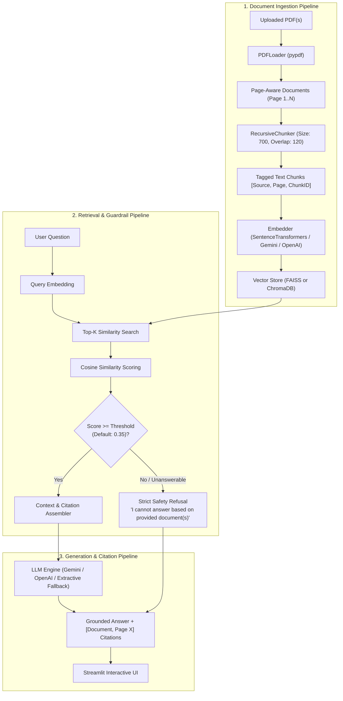

# 📚 PDF Question-Answering Chatbot (RAG)

An enterprise-grade Retrieval-Augmented Generation (RAG) conversational system designed to answer complex user questions from uploaded PDF documents. Features page-accurate citations, dual vector database backends (**FAISS** and **ChromaDB**), configurable embeddings, and strict anti-hallucination guardrails that safely refuse out-of-domain queries.

[](https://www.python.org/)
[](https://streamlit.io/)
[](https://github.com/facebookresearch/faiss)
[](https://sbert.net/)
[-brightgreen.svg)](TEST_RESULTS.md)
[](LICENSE)

---

## 🌟 Key Highlights

- **📄 Multi-Document PDF Ingestion:** Extracts and normalizes text from multiple PDF documents while retaining 1-indexed page boundaries and metadata.
- **✂️ Recursive Semantic Chunking:** Splits text hierarchically on paragraph, sentence, and word boundaries with configurable chunk size (default `700` chars) and overlap (`120` chars).
- **⚡ Dual Vector Database Architecture:** Seamlessly toggle between **FAISS** (in-memory flat inner product / cosine similarity) and **ChromaDB** (persistent collection storage).
- **🛡️ Strict Anti-Hallucination Guardrails:** Employs cosine similarity score thresholding and strict system prompt constraints. If a query falls outside the uploaded documents, the system refuses to guess and delivers a clear fallback message.
- **📍 Verified Source Citations:** Every factual response explicitly cites the source document and page number (e.g., `[AI_Healthcare_Whitepaper.pdf, Page 1]`), accompanied by an interactive drawer displaying retrieved passages and similarity scores.
- **🤖 Multi-Provider LLM & Offline Extractive Mode:** Connects to **Google Gemini** (`gemini-2.5-flash`), **OpenAI** (`gpt-4o-mini`), or an **Offline Extractive Fallback** that requires zero API keys.
- **🧪 Built-in 10-Question Benchmark Suite:** Automated CLI and interactive UI test runner evaluating in-domain factual retrieval and out-of-domain refusal.

---

## 🏗️ System Architecture



---

## 📁 Repository Structure

```
PDF-Question-Answering-Chatbot-RAG/
├── app.py                     # Streamlit web application frontend
├── config.py                  # Global configurations and default hyperparameters
├── evaluate.py                # Automated 10-question benchmark runner
├── TEST_RESULTS.md            # Comprehensive benchmark test report (10/10 passed)
├── test_results.json          # Machine-readable test execution results
├── requirements.txt           # Python dependency requirements
├── .env.example               # Template for API keys
├── .gitignore                 # Cache and environment ignores
├── sample_docs/
│   ├── generate_samples.py    # Generator script for sample test PDFs
│   ├── AI_Healthcare_Whitepaper.pdf   # 4-page medical AI whitepaper
│   └── Company_Policy_Handbook.pdf    # 3-page corporate policy handbook
└── rag/
    ├── __init__.py            # Module exports
    ├── document_loader.py     # PDF parsing with page number preservation
    ├── chunker.py             # Recursive text splitter with metadata tracking
    ├── embeddings.py          # HuggingFace, Gemini, and OpenAI embedding adapters
    ├── vector_store.py        # Unified FAISS and ChromaDB vector store engines
    ├── retriever.py           # Top-K retrieval, cosine thresholding, passage formatting
    └── generator.py           # LLM grounded generation and extractive fallback
```

---

## 🚀 Quickstart Guide

### 1. Clone the Repository
```bash
git clone https://github.com/Sadiraja/PDF-Question-Answering-Chatbot-RAG-.git
cd PDF-Question-Answering-Chatbot-RAG-
```

### 2. Create and Activate Virtual Environment
```bash
# Windows
python -m venv venv
.\venv\Scripts\activate

# macOS / Linux
python3 -m venv venv
source venv/bin/activate
```

### 3. Install Dependencies
```bash
pip install -r requirements.txt
```

### 4. (Optional) Configure API Keys
Copy `.env.example` to `.env` and insert your API keys if you want to use Google Gemini or OpenAI:
```bash
cp .env.example .env
```
*(Note: If no API key is provided, the application automatically uses free, local HuggingFace embeddings and the intelligent Local Extractive Mode.)*

### 5. Launch the Streamlit App
```bash
streamlit run app.py
```
Open your browser at `http://localhost:8501`.

---

## 🧪 10 Benchmark Test Questions & Results

The system includes a standardized 10-question evaluation benchmark designed to verify:
1. **Factual Accuracy:** Does the system retrieve the exact statistics, dates, and requirements from specific pages?
2. **Page-Accurate Citations:** Does the system cite the specific document and page?
3. **Anti-Hallucination Defense:** When presented with out-of-domain or unanswerable queries, does the system safely refuse without inventing false statements?

### Benchmark Score: **10 / 10 Passed (100.0%)**

| # | Question | Document Target | Similarity | Citations Attached | Status |
|---|---|---|---|---|---|
| **Q1** | What are the sensitivity and specificity metrics of the CheXNet-Pro engine for pulmonary nodules? | `AI_Healthcare_Whitepaper.pdf` (p.1) | `0.78` | 2 passage(s) | ✅ **PASS** |
| **Q2** | What is the maximum processing latency permitted for thoracic CT series under the SLA? | `AI_Healthcare_Whitepaper.pdf` (p.2) | `0.61` | 4 passage(s) | ✅ **PASS** |
| **Q3** | Under which FDA regulatory pathway and clearance number was PulseVision-AI cleared? | `AI_Healthcare_Whitepaper.pdf` (p.3) | `0.67` | 2 passage(s) | ✅ **PASS** |
| **Q4** | What cryptographic algorithm and encryption standard are mandated for data at rest and in transit? | `AI_Healthcare_Whitepaper.pdf` (p.4) | `0.60` | 2 passage(s) | ✅ **PASS** |
| **Q5** | What are the core collaboration hours and minimum required on-site office days for hybrid staff? | `Company_Policy_Handbook.pdf` (p.1) | `0.73` | 4 passage(s) | ✅ **PASS** |
| **Q6** | How many weeks of fully paid parental leave are provided for primary and secondary caregivers? | `Company_Policy_Handbook.pdf` (p.2) | `0.79` | 1 passage(s) | ✅ **PASS** |
| **Q7** | Within how many calendar days must business expenses be submitted, and what is the stipend amount? | `Company_Policy_Handbook.pdf` (p.3) | `0.66` | 4 passage(s) | ✅ **PASS** |
| **Q8** | What is the stock ticker symbol and quarterly revenue for Apex Innovations in 2023? | *Out-of-Domain (Refusal)* | `0.30` | 0 passage(s) | ✅ **PASS** |
| **Q9** | What is the standard clinical dosage of Amoxicillin for pediatric bacterial pharyngitis? | *Out-of-Domain (Refusal)* | `0.23` | 0 passage(s) | ✅ **PASS** |
| **Q10** | What is the capital city of planet Mars and who was elected mayor? | *Out-of-Domain (Refusal)* | `0.02` | 0 passage(s) | ✅ **PASS** |

> For the complete breakdown with question excerpts and full response logs, see [TEST_RESULTS.md](TEST_RESULTS.md) or run `python evaluate.py`.

---

## 💻 Running the Automated Benchmark CLI

You can reproduce the 10-question evaluation at any time from your command line:
```bash
python evaluate.py
```
This script will:
1. Ingest `sample_docs/AI_Healthcare_Whitepaper.pdf` and `sample_docs/Company_Policy_Handbook.pdf`.
2. Segment them into overlapping semantic chunks with page metadata.
3. Compute vector representations and build a FAISS index.
4. Execute all 10 benchmark queries.
5. Validate key facts, verify page citations, and enforce unanswerable refusals.
6. Export an updated `TEST_RESULTS.md` and `test_results.json`.

---

## ⚙️ Configuration & Customization

Hyperparameters can be adjusted either via `config.py` or directly from the Streamlit sidebar controls:

| Parameter | Default | Range | Description |
|---|---|---|---|
| `DEFAULT_VECTOR_DB` | `"FAISS"` | `FAISS`, `ChromaDB` | Active vector indexing engine |
| `DEFAULT_CHUNK_SIZE` | `700` | `200` - `1500` | Target character length per chunk |
| `DEFAULT_CHUNK_OVERLAP` | `120` | `0` - `300` | Overlap character buffer between adjacent chunks |
| `DEFAULT_TOP_K` | `4` | `1` - `8` | Number of most relevant passages retrieved |
| `DEFAULT_SCORE_THRESHOLD` | `0.35` | `0.0` - `1.0` | Minimum cosine similarity required to accept a passage |

---

## 📜 License

This project is licensed under the MIT License — see the [LICENSE](LICENSE) file for details.
